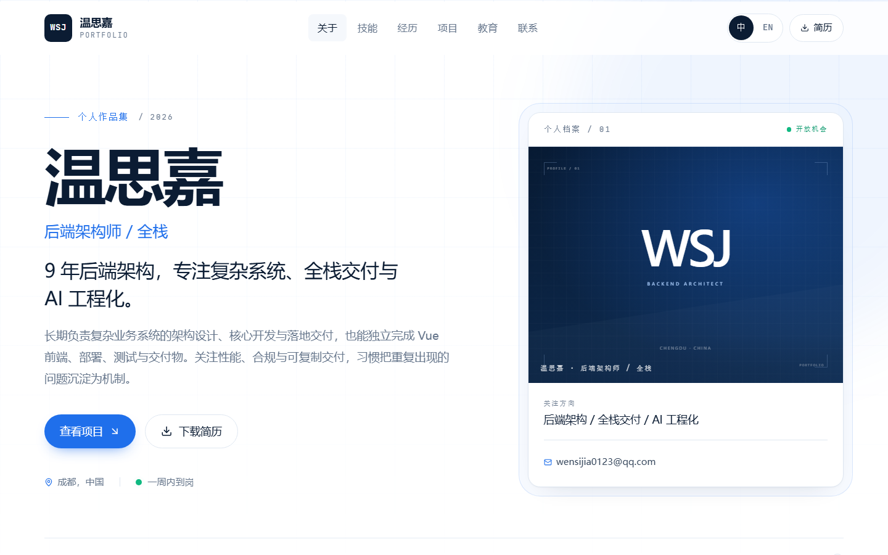

# Personal Portfolio

一个可直接部署到 GitHub Pages 的中英双语个人技术简历网站。极简商务风格，白底、深蓝与科技蓝强调，包含固定导航、七个内容区块、项目案例弹窗和静态 PDF 简历下载。

> 当前内容已按仓库所有者提供的真实简历填写：温思嘉，后端架构师 / 全栈。头像使用 WSJ 字母标识，项目暂无公开链接，PDF 已隐去手机号。后续更新请按照 [内容替换清单](docs/CONTENT-CHECKLIST.md) 操作。



2K/QHD（2560×1440）效果：[100% 缩放](docs/preview-qhd.png)；[150% 缩放](docs/preview-qhd-150.png)。

## 功能

- **七个完整区块**：Hero、About、Skills、Experience、Projects、Education、Contact。
- **中英文切换**：界面文案、简历数据、`<html lang>`、页面标题和 meta description 同步切换，语言偏好保存在本地。
- **项目详情**：卡片打开可访问的模态框，展示背景、方案、结果、职责、时间线、技术栈与链接；支持 ESC、焦点陷阱和滚动锁定。
- **PDF 下载**：使用 `public/resume/` 下的静态文件，不依赖后端或第三方服务。
- **联系方式**：邮箱 mailto、一键复制；配置社交链接后自动展示。
- **响应式**：桌面、平板、手机；390px 宽度下无横向溢出，移动端单栏。根字号随断点从 17px 提升到 20px，2K 屏幕为 23px，版心最大 1600px；2K 屏幕 100% 即有舒适阅读尺寸，浏览器继续放大 125%/150% 时仍会逐级变大。
- **可访问性**：语义化区块、可见焦点、跳过导航、`prefers-reduced-motion`、项目弹窗键盘操作。
- **质量门禁**：ESLint、`vue-tsc`、Vitest、生产构建，全部通过后才允许部署。

## 技术栈

| 层级 | 选择 |
| --- | --- |
| 框架 | Vue 3.5.45 + TypeScript 5.6.3 |
| 构建 | Vite 5.4.11 |
| 样式 | Tailwind CSS 3.4.16 + PostCSS + Autoprefixer |
| 国际化 | Vue I18n 11.4.2 |
| 图标 | Lucide Vue Next 0.468.0 |
| 测试 | Vitest 2.1.8 + Vue Test Utils 2.4.6 + jsdom 25.0.1 |
| 代码规范 | ESLint 9.16.0 + eslint-plugin-vue + typescript-eslint |
| 部署 | GitHub Actions + GitHub Pages |

依赖版本在 `package.json` 中精确锁定，`package-lock.json` 已生成。Node.js 要求 `>=20`。

## 本地开发

```bash
npm ci
npm run dev
```

开发服务器默认运行在 `http://localhost:5173/`。

生产构建与预览：

```bash
npm run build
npm run preview
```

## 常用命令

| 命令 | 说明 |
| --- | --- |
| `npm run dev` | 启动开发服务器 |
| `npm run build` | 构建到 `dist/` |
| `npm run preview` | 本地预览构建产物 |
| `npm run lint` | ESLint 检查，warning 也视为失败 |
| `npm run lint:fix` | 自动修复 ESLint 问题 |
| `npm run typecheck` | `vue-tsc --noEmit` |
| `npm run test` | 运行全部 Vitest 测试 |
| `npm run test:watch` | 监听模式运行测试 |

提交或部署前应全部通过：

```bash
npm run lint
npm run typecheck
npm run test
npm run build
```

## 项目结构

```text
.
├── .github/workflows/deploy.yml   # CI：安装 → 检查 → 测试 → 构建 → 部署
├── docs/
│   ├── CONTENT-CHECKLIST.md       # 内容状态与上线清单
│   └── preview-desktop.png        # README 预览图
├── public/
│   ├── images/avatar-placeholder.svg  # WSJ 字母标识，可替换为照片
│   ├── resume/wensijia-backend-architect.pdf
│   ├── favicon.svg
│   └── .nojekyll                  # 让 GitHub Pages 原样发布静态资源
├── src/
│   ├── components/
│   │   ├── sections/              # 七个页面区块
│   │   ├── AppHeader.vue          # 固定导航、移动菜单、语言切换
│   │   ├── AppFooter.vue
│   │   ├── LanguageToggle.vue
│   │   ├── ProjectDetailModal.vue
│   │   ├── SectionHeading.vue
│   │   └── SocialLinks.vue
│   ├── composables/
│   │   ├── useActiveSection.ts    # 导航高亮
│   │   └── useLocalized.ts        # 读取双语内容
│   ├── data/
│   │   ├── profile.ts             # 个人资料
│   │   ├── skills.ts              # 技能分类
│   │   ├── experience.ts          # 工作经历
│   │   ├── projects.ts            # 项目与详情
│   │   ├── education.ts           # 教育经历与认证
│   │   └── index.ts
│   ├── i18n/
│   │   ├── locales/en.ts          # 英文界面文案
│   │   ├── locales/zh.ts          # 中文界面文案
│   │   └── index.ts
│   ├── styles/main.css            # Tailwind 入口、设计系统与共享样式
│   ├── tests/                     # 单元与集成测试
│   ├── types/content.ts           # 内容类型定义
│   ├── utils/assetUrl.ts          # 兼容 Vite base 的资源地址
│   ├── App.vue
│   └── main.ts
├── AGENTS.md                      # 仓库工程约定
├── index.html
├── tailwind.config.ts
├── vite.config.ts
└── package.json
```

## 替换个人资料

所有可编辑内容都在 `src/data/` 中，组件不需要改。

### 1. 基本资料

编辑 `src/data/profile.ts`：

- `name`：中英文姓名。
- `initials`：导航栏与页脚的两字母缩写。
- `role`、`headline`、`intro`：职位、主张和自我介绍。
- `focus`：Hero 档案卡中的关注方向。
- `availability`、`location`、`email`：求职状态、城市、邮箱。
- `aboutLead`、`aboutBody`：About 区块的简介。
- `quickFacts`：当前职位、城市、语言、到岗时间等。
- `principles`：三到四条工作原则。
- `socials`：GitHub、LinkedIn、个人网站等链接。

### 2. 技能、经历、项目、教育

| 文件 | 内容 |
| --- | --- |
| `src/data/skills.ts` | 技能分类、图标和标签；按解决问题的能力组织，不展示虚构的熟练度分数 |
| `src/data/experience.ts` | 公司、职位、时间、地点、简介、主要贡献、技术栈 |
| `src/data/projects.ts` | 项目卡片与详情：problem / solution / impact / role / timeline / highlights / links |
| `src/data/education.ts` | 学位与认证 |

每个条目都有 `id`，同一集合内必须唯一；双语字段必须同时填写 `zh` 和 `en`。

### 3. PDF 简历

1. 将 PDF 放入 `public/resume/`，例如 `public/resume/resume.pdf`。
2. 修改 `profile.resumeFile` 为 `'resume/resume.pdf'`（不要以 `/` 开头）。
3. 确认文件是真实可打开的 PDF，且不含不希望公开的信息。

当前文件为 `public/resume/wensijia-backend-architect.pdf`，共 2 页，已隐去手机号；测试会检查文件存在且以 `%PDF-` 开头。

### 4. 头像与图标

- 头像：当前为 `public/images/avatar-placeholder.svg` 的 WSJ 字母标识；替换为照片时同步更新 `profile.avatarAlt`。
- favicon：替换 `public/favicon.svg`。
- 社交分享图无需额外配置；页面使用名称、职位和简介生成标题与描述。

### 5. 界面文案

`src/i18n/locales/en.ts` 和 `src/i18n/locales/zh.ts` 保存导航、按钮、标签、空状态等固定文案。

- 两份文件的键必须完全一致。
- 插值占位符（如 `{name}`）必须一致。
- 数据文件中的中英文内容负责简历本身；界面文案负责 UI。

修改后运行：

```bash
npm run test
npm run typecheck
```

## 设计规范

- 主背景：白色；深色联系区：`navy`；强调色：`accent` 科技蓝。
- 内容最大宽度：`max-w-page` = 1600px。
- 圆角、边框、阴影、按钮和标签统一使用 `src/styles/main.css` 中的 `card`、`btn-*`、`tag`、`section-title` 等类。
- 字体：Inter / 系统无衬线 + Noto Sans SC；代码与编号使用等宽字体。
- 动画仅用于入场、悬停和弹窗过渡，并尊重 `prefers-reduced-motion`。
- 移动端单栏；技能与项目卡片在 `sm`/`md` 断点转为两栏。

更完整的工程约定见 [AGENTS.md](AGENTS.md)。

## 测试

```bash
npm run test
```

当前 12 个测试，覆盖：

- 七个区块及其可访问名称。
- 中文默认渲染、英文切换、`lang`、标题与本地存储。
- 项目卡片打开/关闭弹窗、滚动锁定。
- PDF 下载地址、复制邮箱反馈。
- 中英文键与插值占位符一致性。
- 所有双语内容非空、集合 id 唯一。
- 头像和 PDF 静态文件存在、PDF 文件头有效、社交链接为 HTTPS。

## 部署到 GitHub Pages

仓库目标是用户站点 `wensijia.github.io`，因此 `vite.config.ts` 中 `base: '/'`。

### 首次部署

1. 在 GitHub 仓库 **Settings → Pages → Build and deployment** 中，将 **Source** 设为 **GitHub Actions**。
2. 当前仓库的默认分支是 `master`，本地开发分支是 `portfolio-vue`，旧站历史保留在本地 `legacy-static-backup` 分支（基于提交 `8c3bb30`）。工作流同时监听 `main` 和 `master`。
3. 审核并提交 `portfolio-vue` 后，将改动合并到 `master`。如果远端 `master` 仍停在 `8c3bb30`，也可以在确认无分叉后执行：

   ```bash
   git push origin portfolio-vue:master
   ```

   更稳妥的方式是推送 `portfolio-vue` 并在 GitHub 上发起 Pull Request，检查通过后再合并到 `master`。
4. 打开 **Actions → Deploy portfolio to GitHub Pages** 查看运行结果。
5. 部署成功后访问：`https://wensijia.github.io/`。

工作流顺序为：

```text
Checkout → npm ci → Lint → Type check → Test → Build → Configure Pages → Upload artifact → Deploy
```

`deploy` job 通过 `needs: verify-and-build` 依赖检查与构建 job，任何检查失败都不会部署。

### 日常更新

修改 `src/data/`、`src/i18n/locales/` 或 `public/` 中的资源后：

```bash
npm run lint
npm run typecheck
npm run test
npm run build
git add .
git commit -m "content: update resume"
git push
```

推送后 GitHub Actions 自动重新构建并发布，无需手动上传 `dist/`。

### 常见问题

| 现象 | 处理 |
| --- | --- |
| 访问 404 | 检查 Settings → Pages 的 Source 是否为 GitHub Actions；确认工作流在默认分支上成功 |
| 页面样式或 JS 404 | 确认仓库是用户站点且 `base` 为 `/`；若部署在项目子路径，需改为 `/<repo>/` |
| Actions 无法部署 | 检查工作流权限是否包含 `pages: write` 与 `id-token: write`，以及 Pages 环境是否允许部署 |
| 构建通过但线上仍旧 | 等待 Pages 部署完成并强制刷新；检查是否推送到了工作流监听的分支 |
| `npm ci` 失败 | 删除 `node_modules` 后重试；确认 `package-lock.json` 已提交且 Node 版本为 20 |

### 自定义域名

如需绑定自定义域名，在仓库 **Settings → Pages → Custom domain** 配置，并在 `public/` 放置 `CNAME` 文件。当前项目未配置自定义域名。

## 已知限制

- 只有一份中文 PDF 简历；如需英文版本，需要扩展 `Profile` 类型与下载按钮逻辑。
- 项目暂无公开演示或仓库链接，弹窗中显示邮件联系提示。
- 头像为字母标识，未使用个人照片。
- 没有联系表单、后端、访问统计或评论系统，符合纯静态部署目标。
- 内容来自所有者确认的简历；后续修改必须保持事实准确，参见 [内容替换清单](docs/CONTENT-CHECKLIST.md)。

## License

[MIT](LICENSE)
